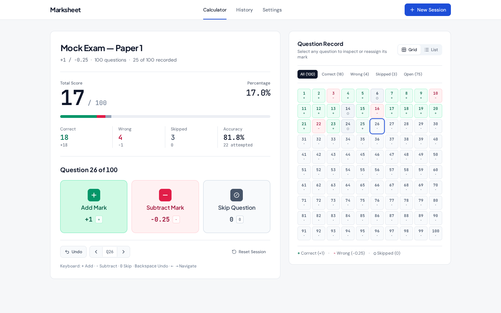

# Marksheet

**A fast, accurate, client-side exam score calculator with question-by-question mark records, negative marking, session history, dark graphite mode, JSON/CSV exports, and persistent browser storage.**

[](https://doctorlestrange.github.io/Marksheet/)
[](https://www.typescriptlang.org/)
[](https://react.dev/)
[](https://tailwindcss.com/)
[](LICENSE)

**Live Demo:** [https://doctorlestrange.github.io/Marksheet/](https://doctorlestrange.github.io/Marksheet/)



---

## Overview

Marksheet is built for grading answer keys quickly and accurately without spreadsheet setup or floating-point rounding drift. Its functional workspace centers on three clear operational buttons — **Add Mark**, **Subtract Mark**, and **Skip Question** — paired with a live 10-column question sheet and running-total ledger that tracks the exact mark assigned to every question number.

Everything runs locally in your browser using `localStorage`. No backend, account, or API key is required.

### Default Configuration
- **Positive mark (Correct):** `+1`
- **Negative mark (Wrong):** `−0.25`
- **Skip question:** `0`
- **Total questions:** `100` (configurable from `1` to `1000`)

---

## Features

- **Three-Button Grading Workflow:** Large, tactile `Add Mark`, `Subtract Mark`, and `Skip Question` actions with keyboard shortcuts for rapid 100-question checking.
- **Exact Decimal Arithmetic:** Derives all totals, breakdowns, and running sums directly from stored question records using `10,000×` integer-scaled arithmetic — eliminating IEEE-754 floating-point drift (such as `0.1 + 0.2 = 0.30000000000000004`) and `-0` display artifacts.
- **Question-by-Question Record Sheet:**
  - **OMR Grid View:** 10-column matrix displaying every question number with dual-coded status symbols (`+`, `−`, `○`, `·`) and semantic colors.
  - **Ledger List View:** Tabular log showing question number, assigned status, exact mark, and cumulative running total.
  - **Filtering & Direct Editing:** Filter by `All`, `Correct`, `Wrong`, `Skipped`, or `Open`. Click any question number to inspect, reassign, or clear its mark without duplicating entries.
- **Undo & Safe Reset:** Multi-step undo restores previous marks and cursor positions; session resets and history deletions use inline confirmations.
- **Persistent Session History & Exports (`localStorage`):**
  - Automatically persists your active in-progress session across browser reloads.
  - Archives completed or paused sessions with an immutable snapshot of their scoring rules and full question-by-question records.
  - Inspect archived question logs, resume past sessions, export any single session as **JSON** or **CSV**, or export **all sessions as JSON** in one click.
- **Dark Graphite Mode:** Neutral dark graphite gray theme (saved to `localStorage` with zero-flash load) alongside crisp light paper mode, toggleable from the top bar or Settings.
- **Configurable Scoring Rules & Presets:**
  - Customize positive mark, negative deduction (including `0` for exams without negative marking), and question count with strict input validation.
  - One-click presets for common exam formats (Standard `+1 / −0.25`, JEE/NEET `+4 / −1`, No Penalty `+1 / 0`, UPSC `+2 / −0.66`).
  - Optional recalculation of the active session without altering archived history sessions.
- **Responsive & Accessible:** Clean desktop and mobile layouts, tabular numerals (`tabular-nums`), semantic ARIA labels, keyboard navigation, and `prefers-reduced-motion` support.

---

## Keyboard Shortcuts

Shortcuts are active on the Calculator screen whenever focus is not inside a text input:

| Key | Action |
| :--- | :--- |
| `+`, `=`, or `1` | **Add Mark** (Correct) |
| `-` or `2` | **Subtract Mark** (Wrong) |
| `0` or `S` | **Skip Question** |
| `Backspace`, `Z`, or `Ctrl/Cmd+Z` | **Undo** last recorded change |
| `←` / `→` | Move to previous / next question |
| `Esc` | Cancel inline reset/delete confirmations |

---

## Getting Started

### Prerequisites

- **Node.js** `20+` (Node `22` recommended)
- **npm** `10+`

### Installation & Local Development

```bash
git clone https://github.com/doctorlestrange/Marksheet.git
cd Marksheet
npm install
npm run dev
```

Open [http://localhost:3000](http://localhost:3000) in your browser.

### Available Scripts

| Command | Description |
| :--- | :--- |
| `npm run dev` | Start the Vite development server on port `3000` |
| `npm run lint` | Run TypeScript type checking (`tsc --noEmit`) |
| `npm test` | Run deterministic unit tests using `node:test` via `tsx` |
| `npm run build` | Create an optimized production bundle in `dist/` |
| `npm run preview` | Preview the production build locally |
| `npm run check` | Run lint, unit tests, and production build sequentially |

---

## Architecture & Accuracy Design

1. **Single Source of Truth:** A session's score is never stored as an independently incremented mutable counter. All totals, counts, accuracy percentages, and running logs are computed purely from `session.records` (keyed by question number `1..N`), guaranteeing zero desynchronization when editing or undoing past questions.
2. **Scaled Integer Math:** All decimal marks are converted to scaled integers (`Math.round(value * 10000)`) before summation and converted back cleanly with `-0` normalized to `0`.
3. **Resilient Persistence:** State is serialized under versioned `localStorage` keys (`marksheet_exam_calculator_v1` and `marksheet_theme_v1`) with cross-tab synchronization. On load, every field is schema-validated, record marks are reconciled against session rules, duplicate IDs are stripped, and corrupted data or restricted browser storage recovers gracefully instead of crashing.

---

## Deployment

Marksheet builds to static assets in `dist/` and deploys cleanly to any static host.

### GitHub Pages (Automated via GitHub Actions)

This repository includes [`.github/workflows/deploy-pages.yml`](.github/workflows/deploy-pages.yml), which automatically configures `VITE_BASE_PATH` for your repository subpath and deploys on every push to `main`:

1. Push this repository to GitHub.
2. Open **Settings → Pages** in your GitHub repository.
3. Under **Build and deployment → Source**, select **GitHub Actions**.
4. Push to `main` (or trigger the workflow manually from the **Actions** tab).

### Vercel

A ready-to-use [`vercel.json`](vercel.json) is included. Import the repository in [Vercel](https://vercel.com) — build command (`npm run build`) and output directory (`dist`) are configured automatically.

### Netlify

A ready-to-use [`netlify.toml`](netlify.toml) is included. Connect the repository in [Netlify](https://www.netlify.com) and deploy directly.

### Cloudflare Pages / Static Hosting

- **Build command:** `npm run build`
- **Output directory:** `dist`
- **Environment variables:** None required (set `VITE_BASE_PATH=/subpath/` only if serving from a subdirectory).

---

## Project Structure

```text
├── .github/
│   ├── ISSUE_TEMPLATE/
│   │   ├── bug_report.md
│   │   └── feature_request.md
│   ├── workflows/
│   │   ├── ci.yml                 # Lint, unit tests, and build check
│   │   └── deploy-pages.yml       # Automated GitHub Pages deployment
│   └── PULL_REQUEST_TEMPLATE.md
├── docs/
│   └── preview.png                # Application screenshot
├── public/
│   └── favicon.svg                # Vector app icon
├── src/
│   ├── components/
│   │   ├── CalculatorView.tsx     # Scoreboard, 3 operational buttons, shortcuts & JSON export
│   │   ├── ErrorBoundary.tsx      # Top-level runtime error recovery boundary
│   │   ├── HistoryView.tsx        # Archived sessions, inspection, JSON & CSV exports
│   │   ├── QuestionRecordPanel.tsx# OMR grid & running-total ledger with auto-scroll
│   │   ├── SettingsView.tsx       # Scoring config, presets, validation & appearance
│   │   └── TopBar.tsx             # Primary navigation, theme toggle & New Session action
│   ├── types/
│   │   └── exam.ts                # Core TypeScript domain models
│   ├── utils/
│   │   ├── scoring.ts             # Pure integer-scaled scoring, JSON/CSV export & session logic
│   │   ├── scoring.test.ts        # Unit tests for math, exports, theme & storage
│   │   ├── storage.ts             # Schema-validated localStorage persistence
│   │   └── theme.ts               # Light / dark graphite theme & download helpers
│   ├── App.tsx                    # Root state & persistence orchestration
│   ├── index.css                  # Tailwind v4 configuration & typography
│   └── main.tsx                   # Application entry point
├── index.html
├── netlify.toml
├── package.json
├── tsconfig.json
├── vercel.json
└── vite.config.ts
```

---

## Contributing

Contributions are welcome! Please read [CONTRIBUTING.md](CONTRIBUTING.md) and our [Code of Conduct](CODE_OF_CONDUCT.md) before opening a pull request.

## License

This project is licensed under the [MIT License](LICENSE).
